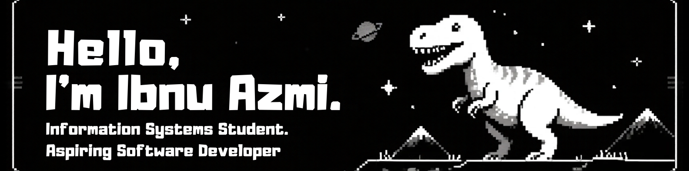

## Tech Stack

 
## About Me

**I'm an Information Systems student at Universitas Bina Sarana Informatika who is interested in Web Development and Data Analytics.**

**Currently, I'm exploring Laravel Development, Database Management, and Data Analytics while building personal and academic projects.**

- 🎓 Information Systems Student — Semester 7
- 💻 Interested in Software Development
- 📊 Learning Data Analytics and Power BI
- 🌱 Always learning new technologies

## GitHub Stats
 

## Play With Me

###

<picture data-importer="pacman">
  <source media="(prefers-color-scheme: dark)" srcset="https://raw.githubusercontent.com/ekawahyu-project/ekawahyu-project/pacman-output/pacman-contribution-graph-dark.svg?game=pacman">
  <source media="(prefers-color-scheme: light)" srcset="https://raw.githubusercontent.com/ekawahyu-project/ekawahyu-project/pacman-output/pacman-contribution-graph.svg?game=pacman">
  
</picture>

###

###

